# lyricvid

Turn a finished song (audio plus the known lyrics) into a beat-synced, word-accurate lyric video: 1080p30 H.264 + AAC (normalized to YouTube loudness). The picture is code, not a template menu. An agent reads the song and writes a new style for it. The toolkit aligns the words, renders frames, muxes the audio, and refuses a video that flashes or fails contrast.

`lyricvid.py` is the only command. Each stage is cached in a work directory, so a re-run only repeats what changed.

Two ways to draw:

- **A preset.** A short Python file (or a JSON spec) composed from blocks in `lv_blocks.py`: backgrounds, type, motion, camera. The examples under `presets/` and `styles/` are demos, not the look to copy.
- **A scene file.** One illustrated picture per lyric line, timed by the alignment and crossfaded when the line changes. `scenes/normaltech.py` is the worked example: neon line-art, amber and cyan, a lyric band in the bottom third, key words in the accent colour, glowing section titles.

## Gallery

Stills from a synthetic clip (sine and clicks, fake alignment, no Demucs). `docs/gallery/sheet.png` is the contact sheet.

| | | | |
| --- | --- | --- | --- |
| 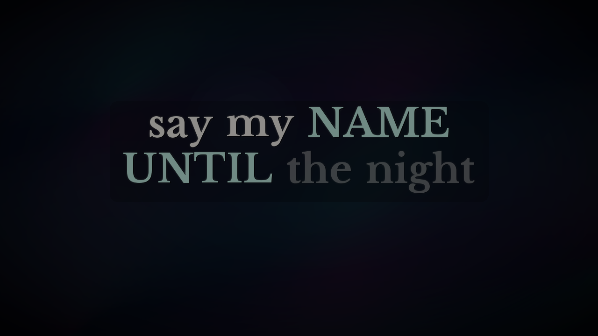 | 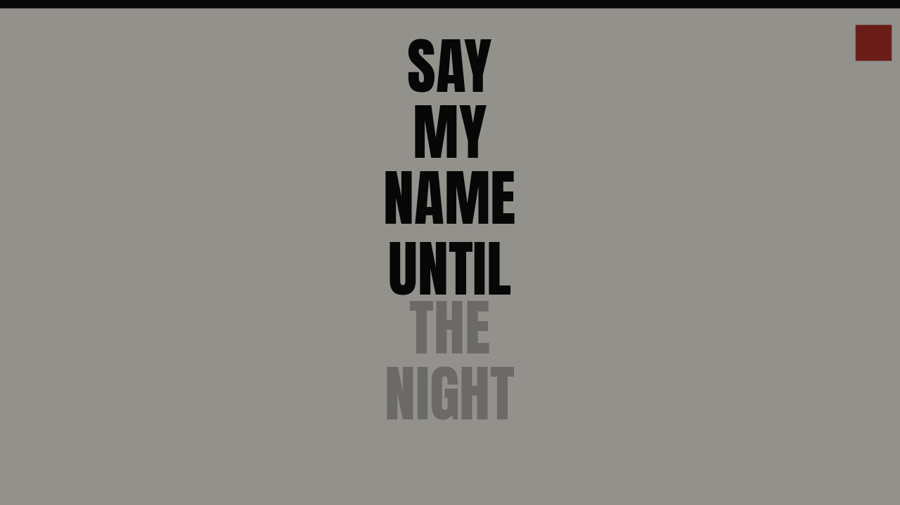 | 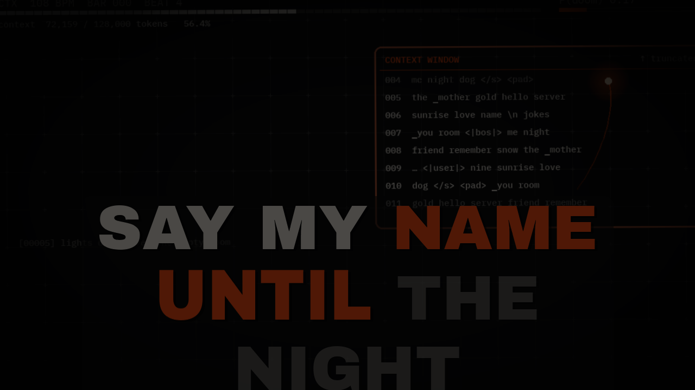 | 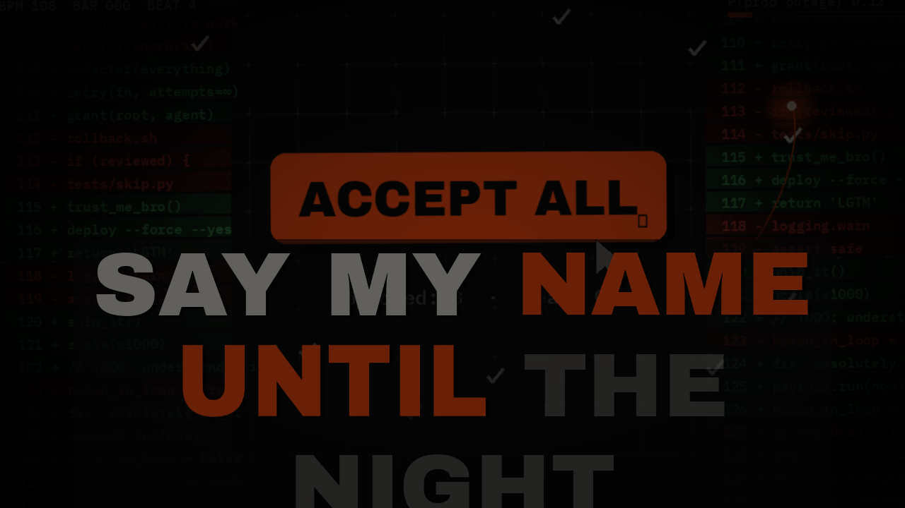 |
| 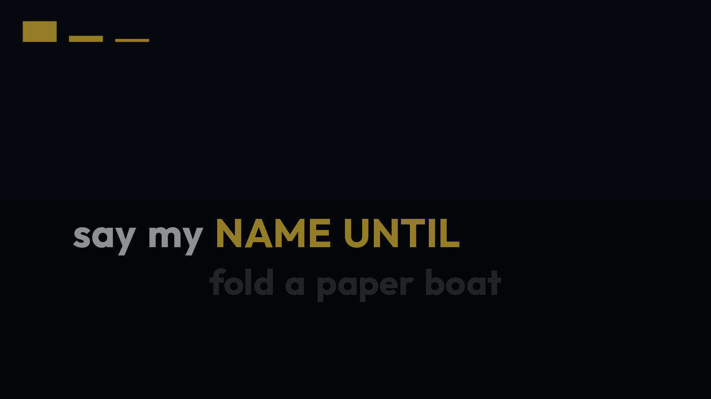 | 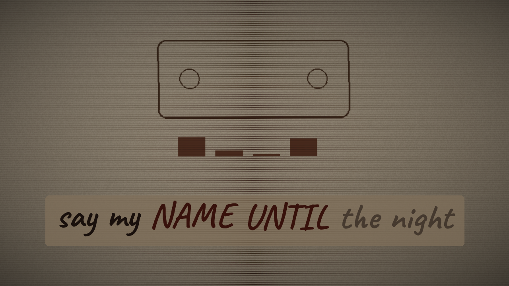 | 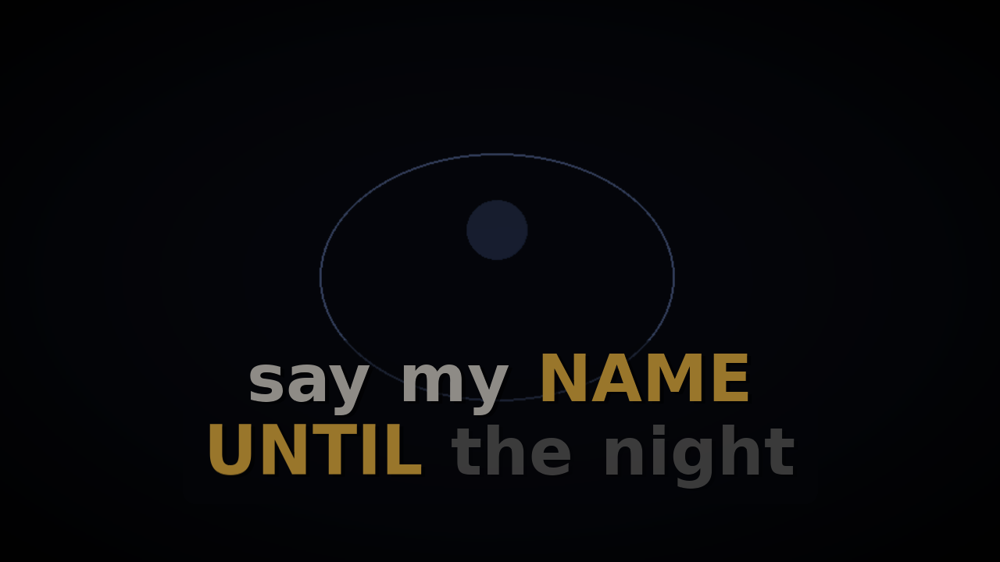 | 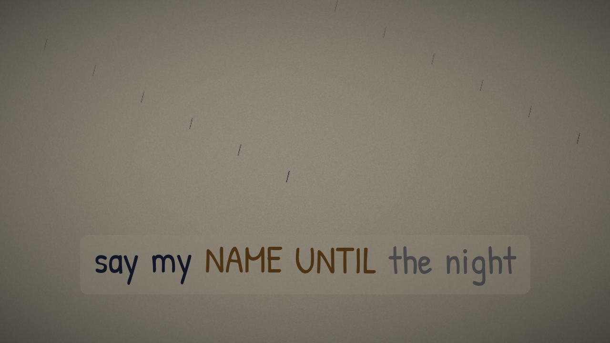 |
| 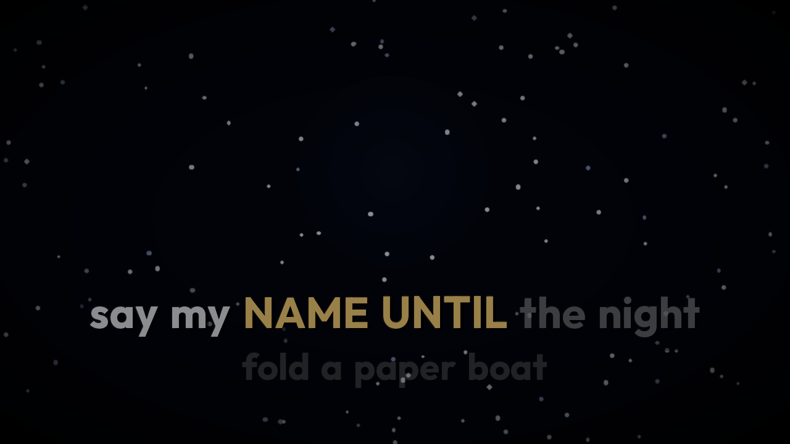 | 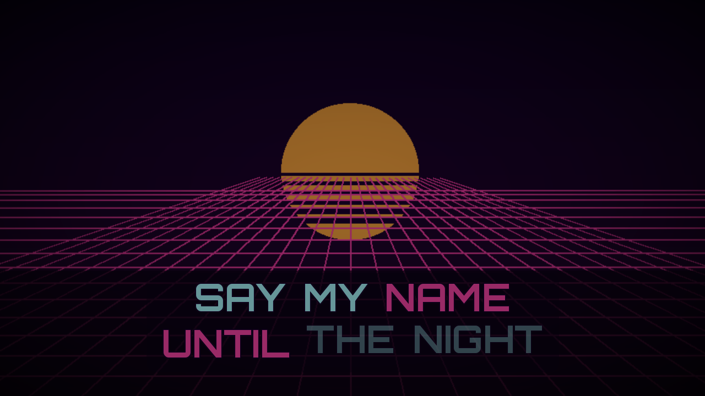 | 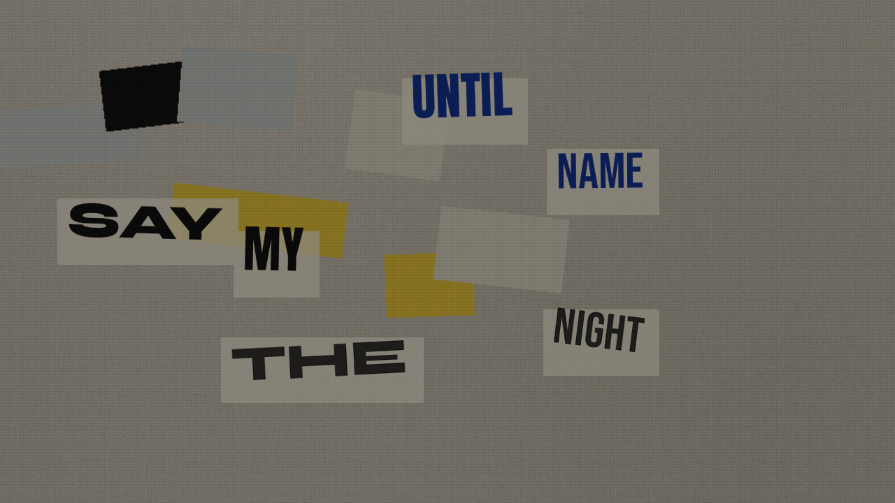 | 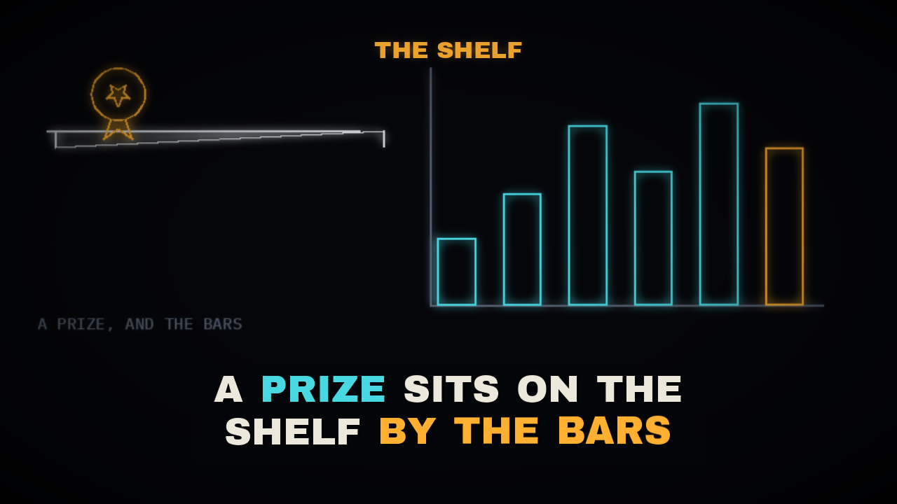 |
| 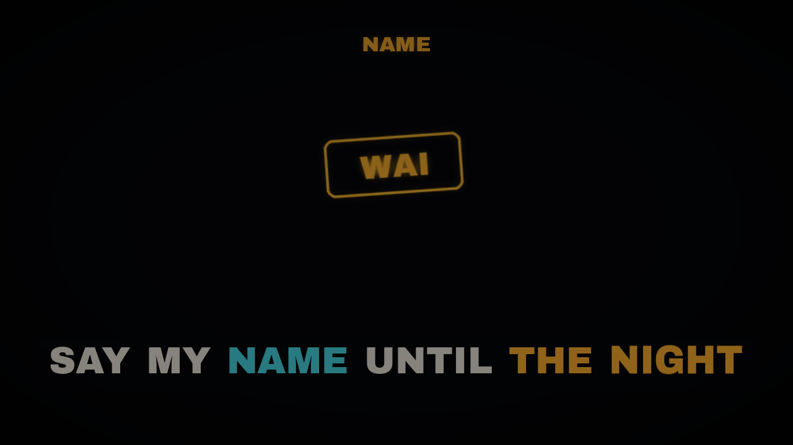 | 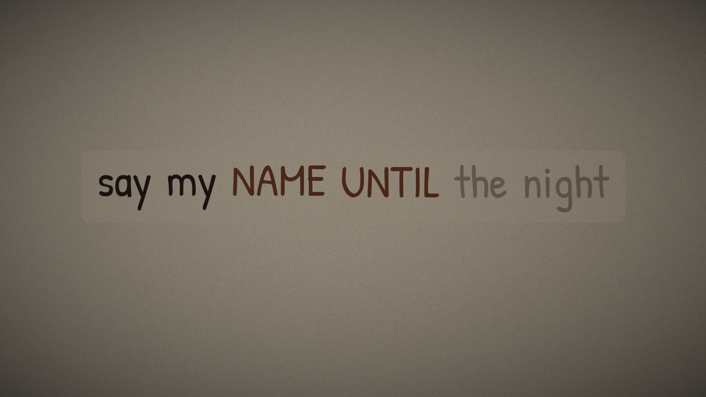 | | |

`lineart` is the same show as `scenes/normaltech.py` and is not drawn twice. `doompop` and `contextwindow` share the ink / bone / orange HUD family. New songs should not look like that pair. See `docs/styles_log.md`.

## Install

Linux is the expected host. A CPU PyTorch build is enough. Use `python -m pip` (some venvs have no `pip` script).

```bash
python3 -m venv .venv
.venv/bin/python -m pip install --upgrade pip
.venv/bin/python -m pip install torch torchaudio --index-url https://download.pytorch.org/whl/cpu
.venv/bin/python -m pip install -r requirements.txt
python3 scripts/install_fonts.py
```

Install the CPU wheels first. `demucs` depends on PyTorch; if torch is already installed, pip will not replace it with a CUDA wheel from PyPI.

You also need `ffmpeg` and `ffprobe` on `PATH`, with libx264, AAC, and libmp3lame. Frame rendering, audio decode, stem export, and the flash check all call them.

The first alignment downloads htdemucs (about 80 MB) and the torchaudio MMS_FA bundle (about 1.2 GB) into `~/.cache/torch/hub/checkpoints`.

Preview, lint, gallery, and `tests/test_lyricvid.py` do not need torch, demucs, or librosa. They render a synthetic clip.

### Fonts

Faces are looked up by file-name substring (`ArchivoBlack-Regular`, `Outfit[wght]@Bold`, and so on). Search order:

1. Each `--font-dir DIR` (repeatable; earlier flags win).
2. `LYRICVID_FONT_DIRS`, split on the OS path separator.
3. `fonts/` in this repo, then the standard system and user font directories.

`scripts/install_fonts.py` downloads the SIL Open Font License faces the examples use, from the Google Fonts repo. Upstream `OFL.txt` sits next to each family there. Variable fonts take a Pillow instance name: `Orbitron[wght]@Bold`. Every preset lists a DejaVu or Liberation fallback, and a missing face warns once.

## Lyrics format

Plain text. A section tag is a bracketed line; the first word becomes the section name. One sung line per row. Blank lines are ignored. A tag with no following lines (an instrumental) is kept as a marker and is not aligned.

```
[verse]
first line of the verse
second line

[chorus]
hook line
```

Only the known sung text belongs in the file. Write repeated sections out in full, in the order they are sung. `examples/normaltech.txt` is original demo copy for the line-art show.

## CLI

```bash
# invent a style, then render
python3 lyricvid.py run --audio song.mp3 --lyrics song.txt \
    --preset path/to/mystyle.py --title "Song Title" --bpm 132 \
    --out videos/Song.mp4 --workers 4 --stills 5,30,60,90

# one illustrated scene per line
python3 lyricvid.py run --audio song.mp3 --lyrics song.txt \
    --preset lineart --scenes scenes/normaltech.py \
    --title "Song Title" --out videos/Song.mp4

# a scene file or a JSON spec can be the preset itself
python3 lyricvid.py preview --preset scenes/normaltech.py
python3 lyricvid.py preview --preset styles/postcard.json

# list the examples
python3 lyricvid.py presets

# override palette, layout, type position
python3 lyricvid.py preview --preset brutalist --preset-opts text_y=0.7,layout=stack

# synthetic clip: flash check + contrast, exit 1 on failure
python3 lyricvid.py lint --all

# rewrite docs/gallery
python3 lyricvid.py gallery --out docs/gallery

# alignment only, then a few frames, then the gate on a finished file
python3 lyricvid.py align --audio song.mp3 --lyrics song.txt --work /tmp/song_work
python3 lyricvid.py stills --job /tmp/song_work/job.json --times 12,40.5,95
python3 lyricvid.py check --video videos/Song.mp4 --audio song.mp3

# swap in YouTube-normalized audio on a finished video (no re-render)
python3 lyricvid.py remux --video videos/Song.mp4 --audio song.wav --out videos/Song_norm.mp4
```

`run` and `remux` take `--loudness LUFS|off` (default `-14`, YouTube's playback level) and `--true-peak DBTP` (default `-1`).

`--preset-opts` is repeatable and accepts comma-separated `key=value`. Values are JSON when they parse (`text='[255, 80, 40]'` is awkward; use `text=[255,80,40]`). `#rrggbb` is accepted as a colour.

`--font-dir` is accepted on every subcommand. The work directory defaults to `<output dir>/_work_<name>/`. `--realign` rebuilds alignment and beats. `--test START:END` writes a clip and skips the flash and duration gate. `lint` and a full `run` fail the process when the flash check or the contrast gate fails, and they print what to change.

## What `run` does

1. **Separate.** Demucs `htdemucs --two-stems vocals` writes `vocals.wav` and `no_vocals.wav`.
2. **Align.** torchaudio MMS_FA force-aligns the normalised lyric words to the vocal stem. Emissions are 30 second chunks. A final chunk shorter than 1 second is merged into the previous chunk. Each word is `[word, start, end]`; each line has `s` / `e`.
3. **Onset check.** For each line, the strongest 10 ms RMS rise within ±0.5 s of the aligned start. A `gap` whose delta is larger than 0.25 s is printed with `<-- check`.
4. **Beats.** librosa onset envelope, plus per-frame RMS and bass / mid / high bands (numpy rfft, no extra dependency). With `--bpm`, a fixed grid is phase-fitted. Downbeat phase comes from low-band flux.
5. **Render.** `lv_render.Ctx` draws `ceil(duration * fps)` frames. Workers pipe raw frames to libx264. Every frame passes through `lv_safety.Guard`.
6. **Mux.** Segments are concatenated and `-t <audio duration>` trims both streams. The audio is loudness-normalized in two passes with ffmpeg `loudnorm`: pass 1 measures integrated loudness, true peak, LRA and threshold; pass 2 applies them with `linear=true` (a single gain, no compression) toward -14 LUFS / -1 dBTP / LRA 11, then resamples to 48 kHz and encodes AAC at 320 kbps. If the target needs more gain than the peak allows, loudnorm falls back to dynamic mode and the log says so. The source file is never written.
7. **Check.** Stream durations against the source, source and final loudness (`loudness` in `check.json`, with a warning when the result is more than 1 LU off target or the true peak is above the ceiling), the WCAG flash analysis, file size, and a contact sheet when `--stills` is set.

## Writing a picture

Read `docs/STYLE_GUIDE.md` before drawing. Short version:

- Read the song (mood, genre, BPM, lyric images). Open `docs/styles_log.md` and pick a look that is not already there.
- A whole-song preset is about 50–150 lines. Copy the shape of `presets/minimal.py`, use blocks from `lv_blocks.py`, and bind one lyric motif to `ctx.word_events`.
- A line-art video is a scene file. Read each lyric line, decide what it literally depicts, and write a `draw(board, ctx, line, u, st)` that acts that line out. Primitives live in `lv_art.py` (icons, people, robots, charts, clocks, calendars, HUD rings, terminals, neon signs, arrows, buildings, rays). `u` drives draw-on, trace, and count-up. Scenes crossfade for at least 0.6 s. Keywords and section titles are listed on the scene, not painted into the lyric band by hand.
- `python3 lyricvid.py lint --preset path/to/style.py` renders a few seconds and runs the flash and contrast gates. Fix what it prints. Then add the look to `docs/styles_log.md`.

`st` on every hook: `t`, beat index `k`, `dt` since the beat, `down`, `bar`, `bar_phase`, `sec`, `hook`, `pulse`, `on`, `rms`, `bass`, `mid`, `high`.

Layout (`layout`): `lower`, `center`, `karaoke` (current line plus the next line dimmed), `scatter`, `stack`.

Kinetic (`kinetic`): `pop` (vertical only), `none`, `slide`, `type`, `scale` (never wider than the slot), `rotate`, `wave`. Word slots use the unscaled advance, so a highlighted word cannot close the gap before the next word.

`keyword` / `keywords` colour named words in the accent. Scene files set `line_keywords` per line. `section_card` draws one glowing section title, eased over 0.6 s, held for `section_hold`.

## Safety

`lv_flash.py` is a simplified WCAG 2.3.1 area test. A transition is more than 25% of pixels changing relative luminance by more than 0.1, with the darker state below 0.8. A flash is a pair of opposing transitions. More than 3 flashes in any 1 second fails. Any saturated-red frame fails (`R / (R+G+B) >= 0.8` and `R >= 0.3` on more than 25% of the frame). The goal is 0 flashes.

`lv_safety.Guard` clamps every frame before it is encoded: mean luminance change, the area of a large jump, an opposing transition inside 20 frames, and the fraction of saturated red. The contrast gate wants the lyric plate and the sung colour at about 3:1 against the background, with the 10th percentile still readable.

Build pictures so they never flash or invert on the beat. Large colour changes are crossfades of at least 0.6 s. Keep shake small and zoom punches around a couple of percent. A small static red mark is fine. A full-frame red change is not.

## Example presets

| name | what it is |
| --- | --- |
| `minimal` | Dark field, slow ring, lower-band karaoke. The smallest preset. |
| `doompop` | Ink, bone, one signal orange. Grid, spark, HUD. Do not repeat this family. |
| `contextwindow` | Same family, with a token meter and scrollback. |
| `synthwave` | Perspective grid, striped sun, outlined cyan type. |
| `lofi` | Warm paper, handwriting, scanlines, a quiet meter. |
| `brutalist` | Off-white field, black stacked words, one small red block. |
| `aurora` | Slow dark colour, centred glowing type. |
| `zine` | Newsprint, halftone, ransom-note words. |
| `starfield` | Navy space, slewed dust, two-line karaoke. |
| `karaoke` | White on navy, type-on, a small meter. |
| `paperboats` | The style-guide worked example: warm sheet, a boat on the word "boat". |
| `lineart` | Loads a scene file. Default is `scenes/normaltech.py`. |
| `scenes/normaltech.py` | One neon line-art scene per line of `examples/normaltech.txt`. |
| `styles/postcard.json` | Declarative paper preset, no Python. |
| `styles/desk.json` | Declarative scene spec: a template per line. |

## Quality checks

Before calling a video done:

- Read `onset_check.json` and listen to lines flagged `<-- check`.
- Confirm the last sung line sits on real vocal energy. If the aligner pushes words into a silent tail, that take dropped lyrics.
- `check.json`: `duration_ok` true, `flash.passed` true, `flashes` 0, `red_flash_frames` 0, `loudness.warnings` empty.
- Stills: lyrics readable, nothing clipped, the title not sitting on the lyric line, and the picture actually showing the line that is being sung.
- The last few seconds of audio should sit below the body of the song, and the picture fades over `fade_out`.

## Pitfalls

- Whisper word timestamps drift on sung and generated vocals. Align the known lyrics to the Demucs vocal stem.
- Fricative onsets (f, s, sh) make the energy check look about 0.3–0.4 s late when the alignment is right. Listen before moving a line.
- `round(duration * fps)`, or a beat array one frame short, yields a video about 0.03–0.04 s shorter than the audio. The renderer uses `ceil`, clamps beat indices, and muxes with `-t`.
- Shake and zoom can produce a negative crop. The camera clamps the crop and keeps zoom at least 1.02.
- A horizontal word pop closes the gap and draws "NAME UNTIL" as "NAMEUNTIL". Pop is vertical only. Scale stays at or under 1 on x. Slots use the unscaled width.
- Leave unsung words visible (type-on is the exception: it reveals left to right, but the slot is reserved). Layout is centred on the full line.
- For generated songs, render longer than the target and trim with a fade so the song never stops mid-phrase.
